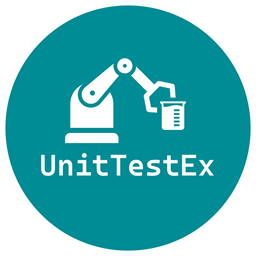

<br/>



<br/>

## Introduction

_UnitTestEx_ provides [.NET testing](https://learn.microsoft.com/en-us/dotnet/core/testing/) extensions for [MSTest](https://github.com/Microsoft/testfx-docs), [NUnit](https://nunit.org/) and [xUnit](https://xunit.net/). It hosts your **real** application (API, Azure Function, or any DI-composed code) inside the test, lets you replace or mock its dependencies, and gives you fluent _Arrange, Act, Assert_ testing with captured logging and detailed JSON-diff assertions.

> **v6** targets .NET 8, 9 and 10, and the Azure Functions **v4 isolated worker** model only. Upgrading? See [Migrating from v5 to v6](./docs/migration-v6.md).

<br/>

## Status

CI | `UnitTestEx` | `UnitTestEx.Azure.Functions` | `UnitTestEx.Aspire` | `UnitTestEx.MSTest` | `UnitTestEx.NUnit` | `UnitTestEx.Xunit`
-|-|-|-|-|-|-
[](https://github.com/Avanade/UnitTestEx/actions?query=workflow%3ACI) | [](https://badge.fury.io/nu/UnitTestEx) | [](https://badge.fury.io/nu/UnitTestEx.Azure.Functions) | [](https://badge.fury.io/nu/UnitTestEx.Aspire) | [](https://badge.fury.io/nu/UnitTestEx.MSTest) | [](https://badge.fury.io/nu/UnitTestEx.NUnit) | [](https://badge.fury.io/nu/UnitTestEx.Xunit)

The [change log](CHANGELOG.md) details all key changes per published version.

<br/>

## Which tester?

Testing... | Use | Package(s) | Hosts | Docs
-|-|-|-|-
An ASP.NET Core API (controllers or minimal APIs) | `ApiTester` | `UnitTestEx` + framework package | `WebApplicationFactory`, full HTTP pipeline | [API testing](./docs/api-testing.md)
An Azure Function (isolated worker) | `FunctionTester` | `UnitTestEx.Azure.Functions` | Your real `Program.cs` host, built but not started; the function is invoked directly | [Azure Functions](./docs/azure-functions.md)
Any DI-composed class or service | `GenericTester` | `UnitTestEx` | Lightweight Generic Host | [Generic testing](./docs/generic-testing.md)
Multiple real services together | `AspireTester` | `UnitTestEx.Aspire` | .NET Aspire `DistributedApplication` | [Aspire](./docs/aspire.md)

The framework package (`UnitTestEx.NUnit`, `UnitTestEx.MSTest` or `UnitTestEx.Xunit`) wires output and assertions into your test framework.

<br/>

## Quick start

**API**: send a real HTTP request through the pipeline, with a downstream `HttpClient` mocked.

``` csharp
var mcf = MockHttpClientFactory.Create();
mcf.CreateClient("XXX", new Uri("https://somesys"))
    .Request(HttpMethod.Get, "products/abc").Respond.WithJson(new { id = "Abc", description = "A blue carrot" });

using var test = ApiTester.Create<Startup>();
test.ReplaceHttpClientFactory(mcf)
    .Controller<ProductController>()
    .Run(c => c.Get("abc"))
    .AssertOK()
    .AssertValue(new { id = "Abc", description = "A blue carrot" });
```

**Azure Function**: `Program.cs` runs as-is, with no test-only structure needed.

``` csharp
using var test = FunctionTester.Create<ProductFunction>();
test.ReplaceHttpClientFactory(mcf)
    .HttpTrigger<ProductFunction>()
    .Run(f => f.Run(test.CreateHttpRequest(HttpMethod.Get, "product/abc"), "abc"))
    .AssertOK()
    .AssertValue(new { id = "Abc", description = "A blue carrot" });

test.ServiceBusTrigger<ServiceBusFunction>()
    .Run(f => f.Run2(test.CreateServiceBusMessageFromValue(new Person { FirstName = "Bob", LastName = "Smith" })))
    .AssertSuccess();
```

**Generic**: any service, with expectations declared up front.

``` csharp
using var test = GenericTester.Create<EntryPoint>();
test.ExpectException().Type<DivideByZeroException>()
    .Run<Gin>(gin => gin.Stir());
```

<br/>

## Capabilities

Each row links to the docs and to a test that shows it working.

Capability | Applies to | Example
-|-|-
Controller tests from a method expression; route, method and body are inferred | API | [`Get_Test1`](./tests/UnitTestEx.NUnit.Test/PersonControllerTest.cs)
Raw HTTP requests, typed responses | API | [`Http_Update_Http2`](./tests/UnitTestEx.NUnit.Test/PersonControllerTest.cs)
`ValidationProblemDetails` / error assertions | API, Function | [`ValidationProblemDetails`](./tests/UnitTestEx.NUnit.Test/ProductControllerTest.cs)
HTTP trigger: `HttpRequest` → `IActionResult` / `IResult` | Function | [`HttpTrigger_ActionResult_Sync`](./tests/UnitTestEx.NUnit.Test/IsolatedFunctionTest.cs), [`HttpTrigger_Result_Async`](./tests/UnitTestEx.NUnit.Test/IsolatedFunctionTest.cs)
HTTP trigger: `HttpRequestData` → `HttpResponseData` | Function | [`HttpTrigger_RequestData_Json`](./tests/UnitTestEx.NUnit.Test/IsolatedFunctionTest.cs)
HTTP method/route validated against `[HttpTrigger]` | Function | [`HttpTrigger_RequestData_RouteCheck`](./tests/UnitTestEx.NUnit.Test/IsolatedFunctionTest.cs), [`WithPathAndQueryCheck`](./tests/UnitTestEx.NUnit.Test/PersonFunctionTest.cs)
Multi-output bindings | Function | [`HttpTrigger_MultiOutput`](./tests/UnitTestEx.NUnit.Test/IsolatedFunctionTest.cs)
Service Bus trigger and message settlement | Function | [`ServiceBusMessage_Success`](./tests/UnitTestEx.NUnit.Test/ServiceBusFunctionTest.cs), [`ServiceBusMessage_AssertActions`](./tests/UnitTestEx.NUnit.Test/ServiceBusFunctionTest.cs)
Event Grid (`EventGridEvent` / `CloudEvent`) builders | Function | [`EventGridEvent_FromValue`](./tests/UnitTestEx.NUnit.Test/EventGridExtensionMethodsTest.cs), [`CloudEvent_FromJson`](./tests/UnitTestEx.NUnit.Test/EventGridExtensionMethodsTest.cs)
Worker middleware pipeline (logging, short-circuit, exception mapping) | Function | [`Middleware_ShortCircuit_ActionResult`](./tests/UnitTestEx.NUnit.Test/IsolatedFunctionTest.cs), [`Middleware_HandlesException_HttpResponseData`](./tests/UnitTestEx.NUnit.Test/IsolatedFunctionTest.cs)
Other triggers (Timer, Blob, Queue, ...) | Function | [`TimerTriggered`](./tests/UnitTestEx.NUnit.Test/ProductFunctionTest.cs), [`BlobTrigger_Bytes`](./tests/UnitTestEx.NUnit.Test/StorageTriggerTest.cs), [`QueueTrigger_Person`](./tests/UnitTestEx.NUnit.Test/StorageTriggerTest.cs), [`GenericTrigger_ServiceBus`](./tests/UnitTestEx.NUnit.Test/IsolatedFunctionTest.cs)
Real `Program.cs` with test overrides; worker never started | Function | [`Program_TestOverrides`](./tests/UnitTestEx.NUnit.Test/IsolatedFunctionTest.cs), [`Program_ServicesUsed_WorkerNotStarted`](./tests/UnitTestEx.NUnit.Test/IsolatedFunctionTest.cs)
Run any service, sync or async | Generic | [`Run_Service`](./tests/UnitTestEx.NUnit.Test/Other/GenericTest.cs)
Scoped services (`ScopedType<T>`) | All | [`ScopedType_RunsWithinServiceScope`](./tests/UnitTestEx.NUnit.Test/Other/DependencyInjectionTest.cs)
Replace / mock DI registrations | All | [`ReplaceSingleton_OverridesRegistration`](./tests/UnitTestEx.NUnit.Test/Other/DependencyInjectionTest.cs), [`MockSingleton_UsesMoqObject`](./tests/UnitTestEx.NUnit.Test/Other/DependencyInjectionTest.cs)
Configuration overrides, `appsettings.unittest.json` | All | [`Configuration_Overrride_Use`](./tests/UnitTestEx.NUnit.Test/Other/GenericTest.cs)
`HttpClient` mocking: match, sequence, delay, times, YAML | All | [`MockSequence`](./tests/UnitTestEx.NUnit.Test/MockHttpClientTest.cs), [`WithYamlRequests`](./tests/UnitTestEx.NUnit.Test/MockHttpClientTest.cs)
`Expect*` before or `Assert*` after | All | [`Update_Test5_ExpectationFailure`](./tests/UnitTestEx.NUnit.Test/PersonControllerTest.cs), [`ExpectValue_WithFunc`](./tests/UnitTestEx.NUnit.Test/Other/ExpectationsTest.cs)
JSON-diff comparison with paths to ignore | All | [`PathsToIgnore_PropertyName`](./tests/UnitTestEx.NUnit.Test/Other/ObjectComparerTest.cs)
Log capture and log assertions | All | [`Get_Test1_ExpectLogNotContains_Failure`](./tests/UnitTestEx.NUnit.Test/PersonControllerTest.cs), [`Checkpoint_WritesReasonAndFlushesLogsToOutput`](./tests/UnitTestEx.NUnit.Test/Other/CheckpointAndDelayTest.cs)
One-off assembly set-up and tester extensions | All | [`TesterExtensions_FunctionTester`](./tests/UnitTestEx.NUnit.Test/Other/OneOffTestSetUpTest.cs)
Multi-host tests with WireMock stubs and log checks | Aspire | [`HttpMock_StubsExternalMockHostDependency_Product`](./tests/UnitTestEx.Aspire.Xunit.Test/AspireTesterTest.cs), [`ErrorWhenLogContains_DefaultsToEnabled_ThrowsWithoutExplicitRegistration`](./tests/UnitTestEx.Aspire.Xunit.Test/AspireTesterTest.cs)

<br/>

## Documentation

- [API testing](./docs/api-testing.md)
- [Azure Functions testing](./docs/azure-functions.md), including [limitations](./docs/azure-functions.md#limitations)
- [Generic testing](./docs/generic-testing.md)
- [Dependency injection and configuration](./docs/dependency-injection-and-configuration.md)
- [HTTP client mocking](./docs/http-client-mocking.md)
- [Assertions, expectations and logging](./docs/assertions-and-expectations.md)
- [Test set-up and extensibility](./docs/test-setup-and-extensibility.md)
- [Aspire multi-host testing](./docs/aspire.md)
- [Migrating from v5 to v6](./docs/migration-v6.md)

<br/>

## Examples

The tests in this repository are the reference examples. Equivalent tests exist for each framework, with only framework-specific differences:
- [UnitTestEx.NUnit.Test](./tests/UnitTestEx.NUnit.Test)
- [UnitTestEx.MSTest.Test](./tests/UnitTestEx.MSTest.Test)
- [UnitTestEx.Xunit.Test](./tests/UnitTestEx.Xunit.Test)
- [UnitTestEx.Aspire.Xunit.Test](./tests/UnitTestEx.Aspire.Xunit.Test), [UnitTestEx.Aspire.NUnit.Test](./tests/UnitTestEx.Aspire.NUnit.Test), [UnitTestEx.Aspire.MSTest.Test](./tests/UnitTestEx.Aspire.MSTest.Test)

<br/>

## Other repos

These other _Avanade_ repositories leverage _UnitTestEx_ to provide unit testing capabilities:
- [_CoreEx_](https://github.com/Avanade/CoreEx) - Enriched capabilities for building business services by extending the core capabilities of .NET.
- [_Beef_](https://github.com/Avanade/Beef) - Business Entity Execution Framework to enable industralisation of API development.

<br/>

## License

_UnitTestEx_ is open source under the [MIT license](./LICENSE) and is free for commercial use.

<br/>

## Contributing

One of the easiest ways to contribute is to participate in discussions on GitHub issues. You can also contribute by submitting pull requests (PR) with code changes. Contributions are welcome. See information on [contributing](./CONTRIBUTING.md), as well as our [code of conduct](https://avanade.github.io/code-of-conduct/).

<br/>

## Security

See our [security disclosure](./SECURITY.md) policy.

<br/>

## Who is Avanade?

[Avanade](https://www.avanade.com) is the leading provider of innovative digital and cloud services, business solutions and design-led experiences on the Microsoft ecosystem, and the power behind the Accenture Microsoft Business Group.
